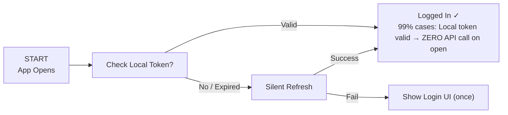
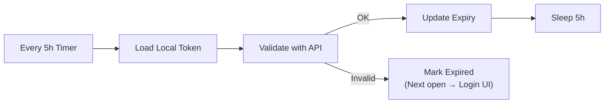
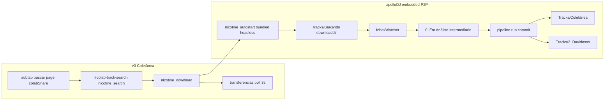

# Apollo DJ Pipeline + WP Auth System
## Skeleton • Structure • Logic Base | 2026 Professional Edition

**Core Principle:**  
**MINIMAL API REQUESTS • 5-HOUR SILENT SESSION CHECK • NO POPUP SPAM • SEAMLESS LOGIN**

---

## Page 1 — High-Level Architecture

### Architecture Diagram

```mermaid
flowchart TB
    subgraph WP["WORDPRESS BACKEND"]
        direction TB
        WP1[WP Plugin (Custom REST API)]
        WP2[Auth Endpoints<br/>/login /refresh /validate]
        WP3[License / User DB]
        WP4[JWT + Refresh Tokens]
    end

    subgraph API["API LAYER (MINIMAL)"]
        API1[Rate Limit • JWT Validate • Cache]
    end

    subgraph EXE[".EXE DESKTOP CLIENT (PyInstaller)"]
        direction TB
        subgraph AUTH["AUTH MODULE"]
            A1[Secure Token Storage (keyring)]
            A2[Background 5h Scheduler]
        end
        subgraph PIPE["PIPELINE CORE"]
            P1[Analyzer (Key/BPM/Beatgrid)]
            P2[Processor (Headroom/Loudness)]
        end
        subgraph UI["UI LAYER (No Popup Spam)"]
            U1[Login Dialog (only on fail)]
            U2[Silent Refresh • Status Bar]
            U3[WaveformViewer • Batch Progress]
            U4[System Tray Icon]
        end
    end

    subgraph PIPE_V2["INGEST PIPELINE v2 (async • fingerprint-first • atomic)"]
        direction TB
        DROP[DROP on playlist target] --> QUEUE[ImportQueue<br/>asyncio + ProcessPool cpu_count-1]
        QUEUE --> STAGE[00 Em análise/<br/>tmp_uuid.ext]
        STAGE --> FV[Fast Validate<br/>ffprobe]
        FV --> FP[FINGERPRINT FIRST<br/>chromaprint -> ffmpeg PCM sha256 -> raw sha256]
        FP -->|HIT| LINK[Attach playlistRef only<br/>SKIP analysis]
        FP -->|MISS| META[Metadata First<br/>mutagen tags + cover]
        META --> HEAVY[Heavy Analysis<br/>apolloBPK + KS key + LUFS + waveform]
        HEAVY --> QG{Quality Gate<br/>weighted score >= 80}
        QG -->|fail| REJ[01 Rejected/]
        QG -->|pass| REN[Canonical Rename<br/>Artist - Title BPM Key]
        REN --> ATOM[Atomic Commit<br/>os.replace -> Tracks/Coletânea]
        ATOM --> XML[XML Commit AFTER file<br/>xml_db debounced 3s atomic save]
        XML --> LINK
        LINK --> READY([READY event])
    end

    subgraph EXPORT["UNIVERSAL EXPORT PRO (0% duplication)"]
        direction TB
        E1[Unified Folder<br/>C:/Users/USER/apolloDJ/Tracks/Coletânea]
        E2[Central Track Model<br/>parsers/track_model.py - path + fingerprint key]
        E3[parsers/<br/>pyrekordbox_in + serato_in + serato2rekordbox]
        E4[exporters/<br/>rekordbox_xml (PIONEER CDJ native) + serato_crates + universal_cdj + sidecar_export]
        E5[Outputs:<br/>Rekordbox XML + Serato crate + DJ Music/ folder + .apollodj.json sidecars + Pendrives/Exportados/]
        E1 --> E2
        E2 --> E3
        E3 --> E4
        E4 --> E5
    end

    PIPE --> PIPE_V2
    PIPE_V2 --> EXPORT

    subgraph STORE["LOCAL STORAGE (pt-BR premium)"]
        S1[Dados/ - cache+DB+analises<br/>Configurações/ - config+backups<br/>Registros/ - logs<br/>Pendrives/ - USB health registry<br/>coletanea.aprio.xml DB]
    end

    subgraph BG["5H BACKGROUND SERVICE"]
        B1[APScheduler / threading • Silent validate]
    end

    WP -->|HTTPS (JWT)| API
    API --> EXE
    EXE --> STORE
    EXE --> BG

    style WP fill:#312e81,stroke:#a855f7,color:#fff
    style API fill:#166534,stroke:#22c55e,color:#fff
    style EXE fill:#1e293b,stroke:#3b82f6,color:#fff
    style STORE fill:#854d0e,stroke:#f59e0b,color:#fff
    style BG fill:#166534,stroke:#22c55e,color:#fff
```

### Legend
- **Purple** = WP/API
- **Blue** = .EXE Client
- **Green** = Success Path
- **Brown** = Storage
- **Teal** = Background

---

## Page 2 — Logic Base: Session Management & Minimal Requests

**Goal:** Keep user logged seamlessly • Check only every 5h • Zero unnecessary API calls • No popup unless absolutely required

### 1. App Launch / Open Flow (Minimal API)



### 2. 5-Hour Background Check (Silent, No UI)



### Key Logic Rules

- **On Open:** ALWAYS prefer local token (JWT expiry check local) → 0 API if valid < 4.5h
- **5h Check:** Only **ONE** `/validate` call per 5h window. Uses refresh token silently. Never shows UI unless refresh fails.

---

## Page 3 — Project Skeleton + Module Structure

### Python .exe Structure

```
apollo_dj/
├── auth/
│   ├── __init__.py
│   ├── token_manager.py          # Secure store + expiry check
│   ├── api_client.py             # Minimal requests (only /validate, /refresh)
│   └── scheduler.py              # 5h background thread (APScheduler)
├── pipeline/
│   ├── orchestrator.py           # Main flow (calls auth.require_valid() before export)
│   └── ... (analyzers/processors)
├── ui/
│   ├── login_dialog.py           # Only shown on auth fail (no popup spam)
│   ├── main_window.py            # Status bar: 'Logged in • Expires in 3h 42m'
│   └── system_tray.py            # Background indicator
├── licensing.py                  # License check on batch start (uses auth)
└── main.py                       # Entry: start scheduler + require_auth()
```

### WP Plugin (PHP)

```
wp-content/plugins/apollo-auth/
├── apollo-auth.php               # Main plugin file + REST registration
├── includes/
│   ├── class-api.php             # /wp-json/apollo/v1/auth/*
│   ├── class-jwt.php             # JWT issue/validate/refresh
│   └── class-license.php         # User license status
└── admin/
    └── settings.php              # API keys, token TTL (5h default)
```

### Core Logic Pseudocode

```python
# auth/token_manager.py
class TokenManager:
    def get_valid_token(self):
        token = load_encrypted()  # keyring or file
        if not token or is_expired(token, buffer=30min):
            return None
        return token  # 99% hit - ZERO API

    def refresh_if_needed(self):
        if needs_refresh(token):  # <30min left
            new = api.refresh(token.refresh_token)
            save_encrypted(new)
            return new
        return token


# scheduler.py (background)
def start_5h_checker():
    scheduler.add_job(
        check_and_refresh,
        'interval', hours=5,
        misfire_grace_time=60
    )

def check_and_refresh():
    token = load()
    if api.validate(token):  # 1 call / 5h
        update_local_expiry()
    else:
        mark_expired()  # Next open = login UI


# main.py / orchestrator.py
def require_valid_user():
    tm = TokenManager()
    token = tm.get_valid_token()
    if not token:
        token = tm.refresh_if_needed()
    if not token:
        show_login_dialog()  # ONLY here
        token = wait_for_login()
    return token

# On batch export:
auth.require_valid_user()
pipeline.run(...)  # proceeds only if logged
```

---

## Page 4 — apolloDJ integrated Collab P2P + Ingest (v3 shell)

**ONE SYSTEM:** P2P is embedded in apolloDJ — never a separate Nicotine+ app, installer, or login UI.

Cross-link: `registry.json` → `apollo_p2p_integrated`, `boot_flow.step_02_apollo_p2p`, `tab_visibility_policy`, `storage_layout.Tracks`.

Membership: `apolloDJ` | `apolloDJ-EXTRA` → bundled headless engine (`{app}/p2p/nicotine.exe` + locked `apollo_backend.conf`) + UI slugs `buscar`, `transferencias` only. Capabilities: **search**, **download**, **share collab folder** — no chat, PM, GUI.



**Note:** `Caixa de Entrada/Nicotine` is an internal inbox folder for manual drops only — Collab P2P downloads land in `Tracks/Baixando` first (`p2p/backend_config.py`).

---

## Summary

**1 API call per 5h max** • **Local-first token check (0ms, 0 network)** • **Login UI only on failure** • **Seamless for 99.9% of sessions** • **Production ready for licensed DJ software**

---

**Final Version • 2026-05-23**  
Converted from original PDF `Apollo_Project_Skeleton_Structure_Logic.pdf` into clean, editable Markdown + Mermaid format.