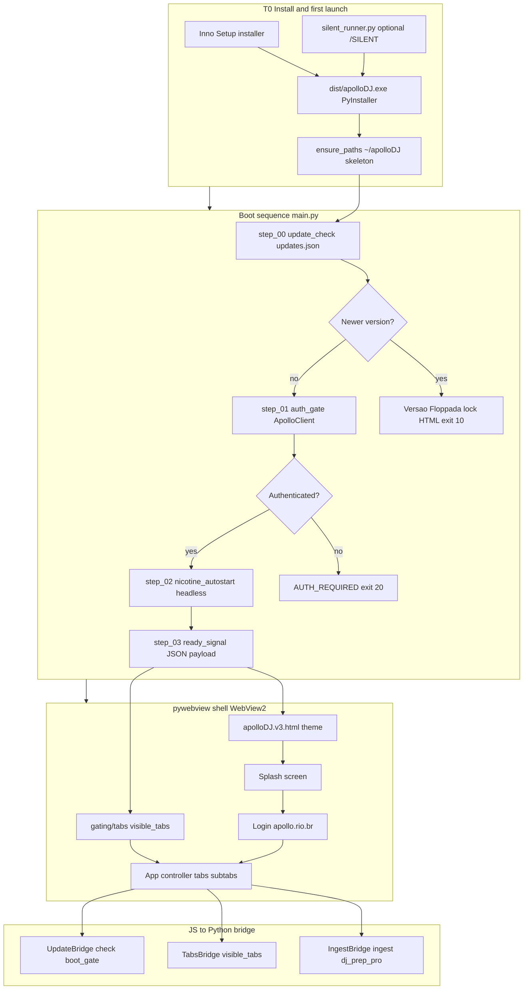
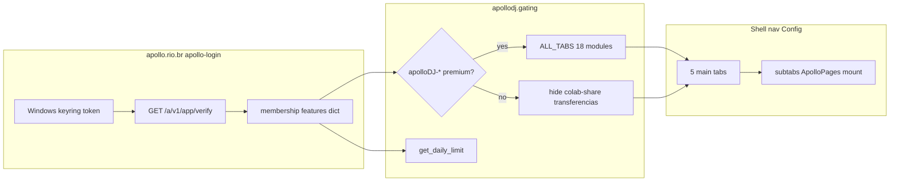
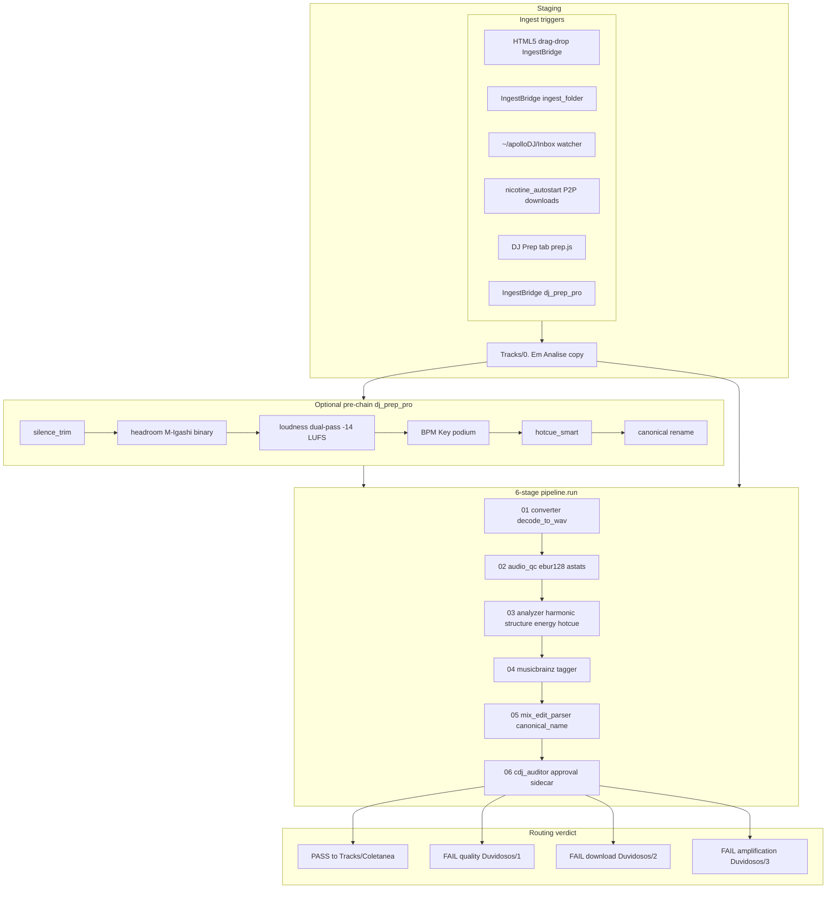
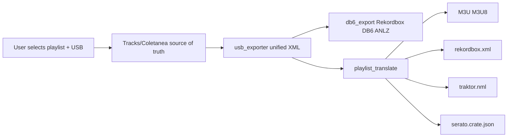
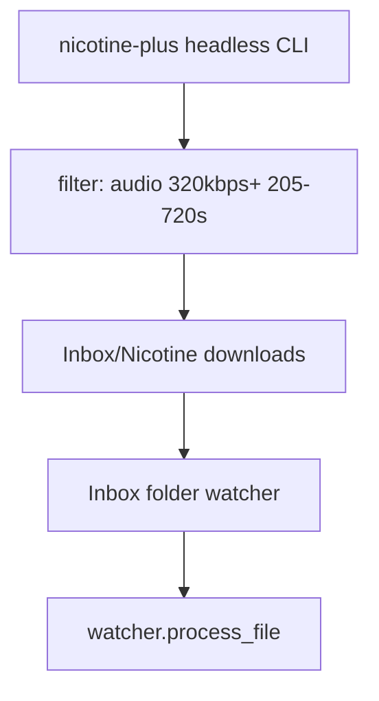
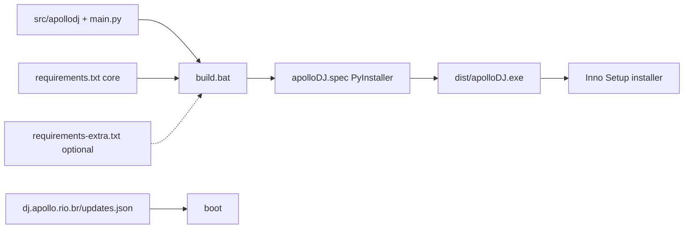

# apolloDJ PRO — full system flow (T=0 → runtime)

> **Canonical machine map:** [`../registry.json`](../registry.json)  
> **Human companion:** [`../mapped.md`](../mapped.md)  
> **UI shell (v3):** `build/theme/screen software/apolloDJ.v3.html`  
> **Last synced:** 2026-05-23

This document is the **single mega-flowchart** for “moment 0” (installed app) through every major feature path. Use it for onboarding, installer wiring, and bridge audits.

---

## 0. What already existed (search result)

| Artifact | Scope | Gap |
|----------|--------|-----|
| [`mapped.md`](../mapped.md) §4–7 | 6-stage pipeline, routing, USB, power-stacks | No install → WebView → tab UX chain |
| [`registry.json`](../registry.json) `boot_flow` | 4 boot steps | No UI / ingest / export subgraph |
| [`main.py`](../main.py) | Boot order + exit codes | CLI smoke only, no shell |
| [`STRICT_AUDIT_STRUCTURE_2026.md`](../../_inventory%20apolloDJ/STRICT_AUDIT_STRUCTURE_2026.md) §6 | Registry ↔ map authority | Not runtime feature flow |
| [`ingest/watcher.py`](../apollodj/ingest/watcher.py) | Auto-ingest comment block | Single-file path only |

**Conclusion:** prepare **`src/docs/APOLLODJ_FULL_FLOW.md`** (this file) as the merged flowchart.

---

## 1. Master flow — installed app → user session



**Exit codes (`main.py`):** `0` ready · `10` update lock · `20` auth required

---

## 2. Auth + feature gating



**Premium-gated tabs:** `colab-share`, `transferencias` ([`gating/tabs.py`](../apollodj/gating/tabs.py))

---

## 3. UI tab map (v3 shell ↔ ApolloPages)

Main nav → subtabs → `ApolloPages.*` module (v1/v2 JS, read-only from Python perspective):

| Main tab | Subtabs | Page key | Module |
|----------|---------|----------|--------|
| **Início** | Painel, Mural, Preferências | `inicio`, `mural`, `userPreferences` | v1 |
| **Coletânea** | Biblioteca, Analisador, Collab.share, Transferências, Buscar, Relatórios | `coletaneaLib`, `analisador`, `colabShare`, `transferencias`, `buscar`, `relatorios` | v2 + v1 |
| **DJ Prep** | Pipeline | `prep` | v1 |
| **Ferramentas** | pendrive.DJ, pendrive.PRO, Converso-Rio, autoHotCUE, autoMEMloop, Waveform, Exportar | `pendriveDj`, `usbPro`, `conversoRio`, `autoHotCue`, `autoMemLoop`, `waveform`, `exportar` | v1 |
| **Controladora** | Controladora | `controladora` | v1 |

**v3-only UX layer:** `v3/v3-patches.js` + `v3/biblioteca-dnd.js` (Biblioteca DnD, row ctx, compact tables) — does not replace Python ingest.

**Also loaded (parity / future):** `editor-tags.js`, `ajuste-som.js`, simulated-data stubs per tab.

---

## 4. Ingest — every path into the pipeline



**Rule ([`watcher.py`](../apollodj/ingest/watcher.py)):** auto-ingest always runs **full** pipeline with `commit=True` — no partial analysis on drop.

**Dry mode:** `pipeline.run(..., commit=False)` — safe preview, no moves (dev / UI preview).

---

## 5. Podium pattern (every engine tries 1st → falls back)

Each stage uses **Top-3+ Podium** ([`mapped.md`](../mapped.md) §2, [`registry.json`](../registry.json) `podium.features`):

| Feature | 1st | 2nd | 3rd+ |
|---------|-----|-----|------|
| BPM | libraz/bpm-detector | BeatNet | legacy hybrid → librosa |
| Key | bpm-detector NewKeyDetector | harmonic_mixer | librosa KS |
| QC | ffmpeg ebur128+astats | pyloudnorm | pydub |
| Loudness | ffmpeg dual-pass loudnorm | ffmpeg-normalize | single-pass / pyloudnorm |
| Headroom | M-Igashi Rust binary | legacy headroom.py | ffmpeg alimiter |
| Structure | bpm-detector structure | madmom downbeats | librosa segments |
| HotCues | structure+energy | quantizer +8 | 16-bar grid |
| Metadata | musicbrainzngs | acoustid | filename regex |
| Tags | mutagen | analyze-tag-songs | ffmpeg metadata |
| Waveform UI | libdjwaveform C | Pillow love12 | librosa matplotlib |
| Auth | ApolloClient token | wp-api-client | config.ini 24h grace |

Missing `requirements-extra.txt` libs → **silent step-down**, app never hard-crashes (priority C).

---

## 6. USB export (user-triggered)



---

## 7. Background services at runtime



---

## 8. Build / deploy chain (not runtime, but T=0 origin)



**Theme assets:** `build/theme/screen software/apolloDJ.v3.html` + `v1/` + `v2/` + `cdn.apollo.rio.br/` bundled as PyInstaller `datas`.

---

## 9. Power-stacks (composed workflows)

From [`registry.json`](../registry.json) `stacks`:

| Stack | Use case | Module chain |
|-------|----------|--------------|
| **A** Full CDJ prep | Club-ready library | silence_trim → loudness → analyzer → harmonic → tagger → db6_export |
| **B** Ultra accuracy | Max precision | madmom analyzer → bpm-detector structure → ANLZ → libdjwaveform |
| **C** Smart hotcues | CDJ cue points | structure → downbeats → energy → hotcue_smart → db6_export |
| **D** Metadata repair | Tag fixes | tagger scan → musicbrainz → tagger write → analyzer → audio_qc |
| **E** Nicotine discovery | P2P ingest | nicotine_autostart → audio_qc → quick analyzer → tagger → approval |
| **F** pywebview UI | Desktop shell | launcher → bridge/* → playback/preview → ui/waveform |

---

## 10. Quick reference — storage layout

```
~/apolloDJ/
├── Tracks/
│   ├── 0. Em Analise/          ← staging on ingest
│   ├── Coletanea/              ← MASTER (PASS)
│   └── 2. Duvidosos/
│       ├── 1. Arquivo duvidoso/
│       ├── 2. Download falhado/
│       └── 3. Falha de amplificação/
├── Playlists/apolloDJ/         ← unified XML
├── Inbox/                      ← Nicotine + imports
├── Cache/                      ← temp_wav, spectrograms
├── Logs/
└── Database/                   ← tracks.db, fingerprints.db
```

---

## 11. Maintenance

When adding a feature:

1. Wire module under `apollodj/` and list in `registry.json` → `modules`
2. Add podium row in `registry.json` → `podium.features` + row in `mapped.md` §2
3. If UI-facing: register `ApolloPages.*` in v1/v2 JS + `Config` in v3.html + optional `gating/tabs.py`
4. If ingest-related: extend §4 diagram + ensure `watcher.process_file` or `IngestBridge` exposes it
5. Update **this file** §3 or §4 subgraph
